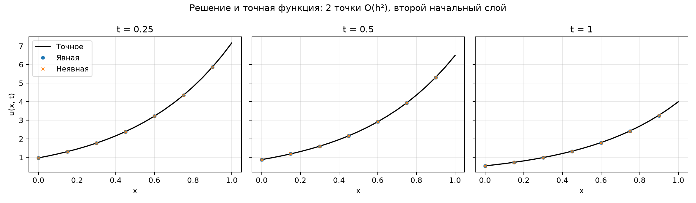
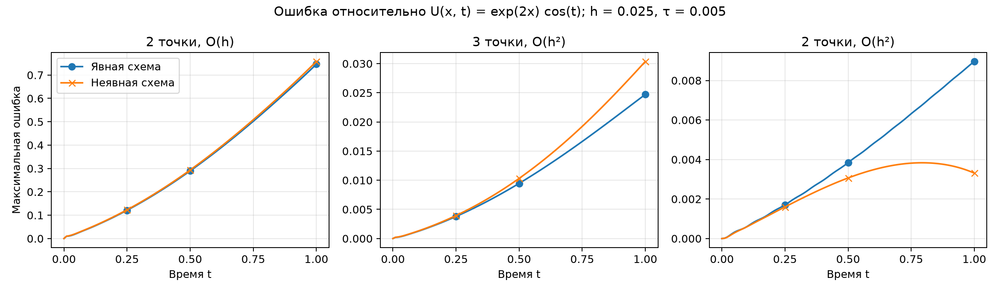
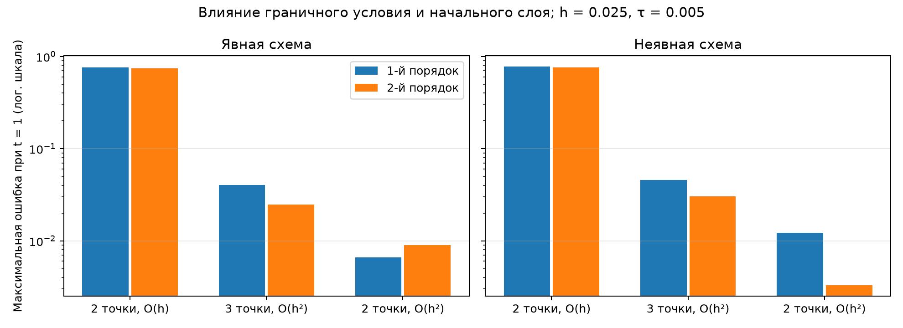
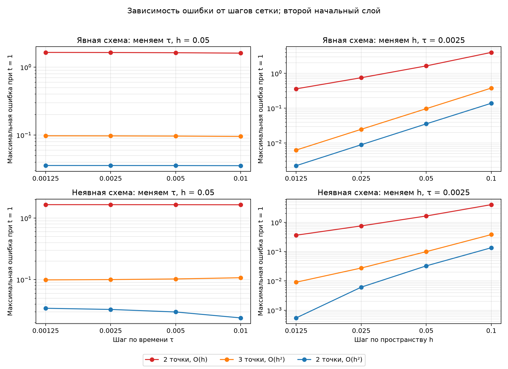

# Лабораторная №6: волновое уравнение

Программа в `main.py` решает задачу на отрезке `0 ≤ x ≤ 1` до момента `T = 1`. Она перебирает две схемы по времени, два способа получить первый временной слой и три способа задать условия на границах. Для каждого сочетания выводится максимальная ошибка в моменты `t = 0.25`, `0.5`, `1`. Затем отдельно меняются шаги по времени и по пространству.

## Точное решение и сетка

Для проверки используется данное в задании решение

$$
U(x,t)=e^{2x}\cos t.
$$

Действительно, $U_{tt}=-U$, а $U_{xx}-5U=(4-5)U=-U$. На обеих границах $U_x=2U$. При $t=0$ имеем $U=e^{2x}$ и $U_t=0$.

Пространственные узлы: $x_i=ih$, $h=1/n$. Временные узлы: $t_k=k\tau$, $\tau=1/\text{steps}$. Число $u_i^k$ приближает $u(x_i,t_k)$. Вторую производную по пространству во внутренних узлах заменяем разностью

$$
D_{xx}u_i^k=\frac{u_{i-1}^k-2u_i^k+u_{i+1}^k}{h^2}.
$$

## Первый временной слой

Нулевой слой известен: $u_i^0=e^{2x_i}$. Для слоя $t=\tau$ раскладываем решение по времени:

$$
u(x,\tau)=u(x,0)+\tau u_t(x,0)+\frac{\tau^2}{2}u_{tt}(x,0)+\ldots
$$

Здесь $u_t(x,0)=0$, а из уравнения $u_{tt}(x,0)=u_{xx}(x,0)-5u(x,0)=-e^{2x}$. Поэтому:

- первый порядок: $u_i^1=e^{2x_i}$;
- второй порядок: $u_i^1=e^{2x_i}(1-\tau^2/2)$.

Первый вариант отбрасывает квадратичный член, второй его учитывает. Начальное приближение применяется и к граничным узлам; начиная со следующего слоя, там используются выбранные граничные формулы.

## Схемы по времени

**Явная схема «крест»** вычисляет новый слой из двух уже известных:

$$
u_i^{k+1}=2u_i^k-u_i^{k-1}
+\tau^2\left(D_{xx}u_i^k-5u_i^k\right),\qquad 1\le i<n.
$$

Для неё выбирают достаточно маленький шаг по времени. В программе проверяется условие $\tau\le 2/\sqrt{4/h^2+5}$; использованные для таблиц шаги также удовлетворяют обычному ориентиру $\tau/h\le1$.

**Неявная схема** вычисляет пространственную разность уже на новом слое:

$$
u_i^{k+1}-\tau^2\left(D_{xx}u_i^{k+1}-5u_i^{k+1}\right)
=2u_i^k-u_i^{k-1}.
$$

Теперь значения нового слоя зависят друг от друга, поэтому на каждом шаге решается система линейных уравнений. Её матрица не меняется со временем: программа строит и раскладывает её один раз. Такая полностью неявная схема обычно даёт дополнительное численное затухание и имеет первый порядок точности по времени.

## Три аппроксимации границ

Граничное условие с обеих сторон имеет вид $u_x-2u=0$.

1. **`2p1`, две точки, первый порядок по $h$:**

   $$
   \frac{u_1-u_0}{h}-2u_0=0,\qquad
   \frac{u_n-u_{n-1}}{h}-2u_n=0.
   $$

2. **`3p2`, три точки, второй порядок по $h$:**

   $$
   \frac{-3u_0+4u_1-u_2}{2h}-2u_0=0,\qquad
   \frac{3u_n-4u_{n-1}+u_{n-2}}{2h}-2u_n=0.
   $$

3. **`2p2`, две точки, второй порядок по $h$:** в формуле Тейлора для производной появляется $u_{xx}$. Заменяем его из самого уравнения: $u_{xx}=u_{tt}+5u$. Например, слева

   $$
   u_x(0,t)=\frac{u_1-u_0}{h}-\frac h2(u_{tt,0}+5u_0)+O(h^2).
   $$

   После подстановки граничного условия получаем уравнения для крайних узлов:

   $$
   u_{tt,0}=\frac{2(u_1-u_0)}{h^2}-\frac{4u_0}{h}-5u_0,
   \qquad
   u_{tt,n}=\frac{2(u_{n-1}-u_n)}{h^2}+\frac{4u_n}{h}-5u_n.
   $$

   В явной схеме правые части берутся на текущем слое, в неявной — на новом. Крайние узлы входят в решение так же, как внутренние, без третьего пространственного узла.

Для первых двух способов явная схема сначала считает внутренние узлы нового слоя, затем находит крайние из граничных равенств. В неявной схеме эти равенства становятся первой и последней строками матрицы.

## Как это представить на бумаге

Рисуем прямоугольную сетку: вправо идёт координата $x$, вверх — время $t$. Чтобы узнать значение в середине следующего ряда, смотрим на три соседние точки текущего ряда и на точку прямо под ними в предыдущем ряду. Это «крест»: он говорит, как пространственная кривизна меняет движение волны. В неявном варианте сначала мысленно рисуем весь следующий ряд и подбираем его значения одновременно так, чтобы равенства выполнились во всех узлах.

На краях обычного креста не хватает соседа. Можно приблизить наклон по двум точкам, по трём точкам точнее, либо использовать само дифференциальное уравнение, чтобы поправить двухточечную оценку наклона. Второй начальный ряд нужен потому, что уравнение содержит вторую производную по времени: для движения нужны два ряда, как для траектории нужны начальные положение и скорость.

## Что показывают вычисления

Ошибка вычисляется как $E(t)=\max_i|u_i^k-U(x_i,t)|$. При `tau = 0.0025`, втором порядке начального слоя и сгущении пространственной сетки `h = 0.1, 0.05, 0.025, 0.0125` явная схема дала при `t = 1`:

| Граница | 0.1 | 0.05 | 0.025 | 0.0125 |
|---|---:|---:|---:|---:|
| `2p1` | 4.003 | 1.642 | 0.7515 | 0.3604 |
| `3p2` | 0.3796 | 0.09724 | 0.02487 | 0.006306 |
| `2p2` | 0.1391 | 0.03565 | 0.008976 | 0.002249 |

При уменьшении $h$ вдвое ошибка `2p1` уменьшается примерно вдвое, а у `3p2` и `2p2` — примерно вчетверо. Это согласуется с первым и вторым порядками граничных формул. При фиксированном $h$ уменьшение $\tau$ не обязано монотонно уменьшать **полную** ошибку: пространственная ошибка остаётся, а временная может частично её компенсировать. Поэтому таблица по $\tau$ показывает влияние шага времени на полную ошибку именно при выбранном $h$; для оценки чистого временного порядка нужен отдельный эксперимент с пренебрежимо малой пространственной ошибкой или сравнение с решением на той же пространственной сетке и очень мелким шагом времени.

## Графики

Запуск из корня проекта: `poetry run python lab6/main.py`. Графики сохраняются в `lab6/plots`.

Точки обеих схем почти лежат на линии точного решения. Здесь использованы граничная аппроксимация `2p2`, второй порядок начального слоя, `h = 0.05` и `τ = 0.01`.

Для каждой точки графика ошибка вычислена сравнением численного решения с $U(x,t)=e^{2x}\cos t$ во всех пространственных узлах: $E(t)=\max_i|u_i(t)-U(x_i,t)|$. Отмечены моменты $t=0.25$, $0.5$ и $1$, для которых программа также печатает численные значения. У каждого граничного варианта своя вертикальная шкала, чтобы видеть различия явной и неявной схем.

Столбцы показывают максимальную ошибку при `t = 1`: чем ниже столбец, тем точнее результат. Вертикальная шкала логарифмическая, чтобы одновременно были видны большие и маленькие ошибки. Иногда первый порядок начального слоя даёт меньшую **полную** ошибку в отдельном опыте: временная и пространственная ошибки могут частично компенсироваться.

Слева меняется только `τ`, справа — только `h`. Верхний ряд относится к явной схеме, нижний — к неявной. Обе оси логарифмические; при фиксированном `h` линии слева почти горизонтальны, потому что преобладает пространственная ошибка.
