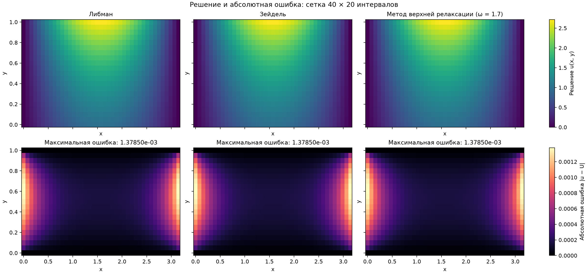
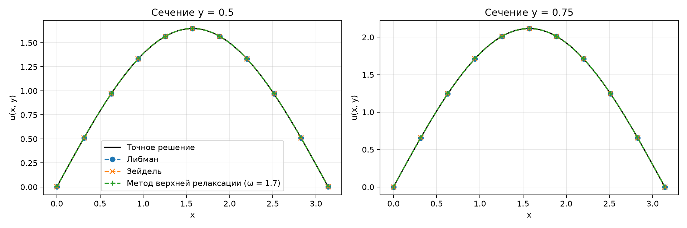
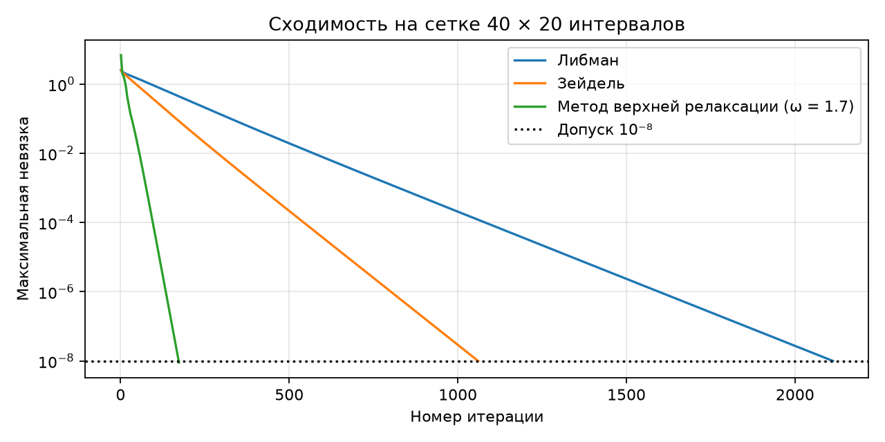
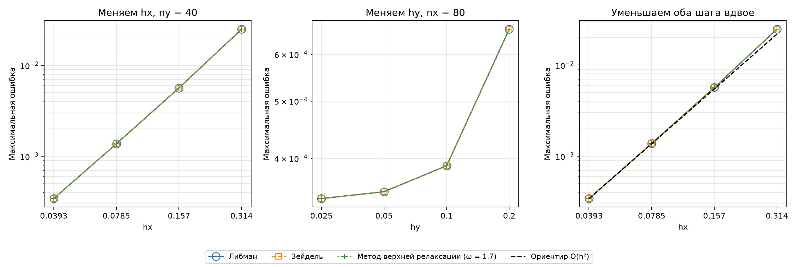

# Лабораторная №7. Уравнение Лапласа

## Что нужно найти

Ищем функцию — высоту поверхности — внутри прямоугольника
$0\le x\le\pi$, $0\le y\le1$. В каждой внутренней точке она удовлетворяет уравнению

$$
u_{xx}+u_{yy}=0.
$$

На нижней и верхней сторонах известна сама высота, а на левой и правой — наклон по направлению оси $x$:

```text
                         u(x, 1) = e sin(x)
                   y ↑
                   1 ┌─────────────────────┐
                     │                     │
      u_x(0,y) = e^y │    u_xx + u_yy = 0  │ u_x(π,y) = -e^y
                     │                     │
                   0 └─────────────────────┘ → x
                     0                     π
                          u(x, 0) = sin(x)
```

Производная $u_x$ на обеих сторонах считается вправо, вдоль оси $x$.
Знак справа уже указан в условии: дополнительно менять его не нужно.
Здесь $y$ — вторая пространственная координата, а не время.

Для проверки дано точное решение

$$
U(x,y)=\sin x\,e^y.
$$

У него $U_{xx}=-\sin x\,e^y$, а $U_{yy}=\sin x\,e^y$: сумма равна нулю.
Кроме того, $U_x=\cos x\,e^y$, откуда получаются обе заданные производные.
Подстановка $y=0$ и $y=1$ даёт оставшиеся граничные условия.
Точное решение используется для проверки и графиков; итерации его не используют.

## 1. Заменяем поверхность таблицей чисел

Делим стороны на `nx` и `ny` интервалов:

$$
h_x=\frac\pi{n_x},\qquad h_y=\frac1{n_y},\qquad
x_i=ih_x,\qquad y_j=jh_y.
$$

Число $u_{i,j}$ приближает $u(x_i,y_j)$. Всего узлов $(n_x+1)(n_y+1)$.
В программе это массив `u[i, j]`: первый индекс отвечает за $x$, второй — за $y$.

```text
        j ↑
     ny   ●───●───●───●───●   верхняя сторона известна
          │   │   │   │   │
          ●───○───○───○───●
          │   │   │   │   │
          ●───○───○───○───●   ○ — внутренние неизвестные
          │   │   │   │   │
      0   ●───●───●───●───●   нижняя сторона известна
          0              nx → i
```

Боковые значения тоже неизвестны, но их можно выразить через внутренние узлы.
В углах оставляем значения нижнего и верхнего условий Дирихле. Формулы для боковых производных применяем при $1\le j<n_y$.

## 2. Центрально-разностная схема

Вторую производную заменяем разностью трёх соседних значений:

$$
u_{xx}(x_i,y_j)\approx
\frac{u_{i-1,j}-2u_{i,j}+u_{i+1,j}}{h_x^2},
\qquad
u_{yy}(x_i,y_j)\approx
\frac{u_{i,j-1}-2u_{i,j}+u_{i,j+1}}{h_y^2}.
$$

Получаем систему уравнений во всех внутренних узлах:

$$
\frac{u_{i-1,j}-2u_{i,j}+u_{i+1,j}}{h_x^2}
+\frac{u_{i,j-1}-2u_{i,j}+u_{i,j+1}}{h_y^2}=0.
$$

Одна строка системы использует «крест» из пяти точек:

```text
                    u[i,j+1]
                        │
        u[i-1,j] ─── u[i,j] ─── u[i+1,j]
                        │
                    u[i,j-1]
```

Обозначим $a_x=1/h_x^2$, $a_y=1/h_y^2$. Выразим центральное значение:

$$
u_{i,j}=
\frac{a_x(u_{i-1,j}+u_{i+1,j})+a_y(u_{i,j-1}+u_{i,j+1})}
{2(a_x+a_y)}.
$$

Это взвешенное среднее четырёх соседей. При одинаковых шагах получается обычное среднее:

$$
u_{i,j}=\frac{u_{i-1,j}+u_{i+1,j}+u_{i,j-1}+u_{i,j+1}}4.
$$

Например, если значения соседей равны $1,2,3,2$, центр должен равняться $2$.
Если шаги разные, соседи по более мелкому направлению получают больший вес.
Центральная схема имеет погрешность аппроксимации $O(h_x^2+h_y^2)$ для гладкой функции.

## 3. Как учесть производные на боковых сторонах

Вне прямоугольника значений нет. Поэтому производные на границах приближаем односторонними трёхточечными формулами второго порядка:

$$
\frac{-3u_{0,j}+4u_{1,j}-u_{2,j}}{2h_x}=e^{y_j},
\qquad
\frac{3u_{n_x,j}-4u_{n_x-1,j}+u_{n_x-2,j}}{2h_x}=-e^{y_j}.
$$

Отсюда крайние значения:

$$
u_{0,j}=\frac{4u_{1,j}-u_{2,j}-2h_xe^{y_j}}3,
\qquad
u_{n_x,j}=\frac{4u_{n_x-1,j}-u_{n_x-2,j}-2h_xe^{y_j}}3.
$$

```text
    левая сторона                     правая сторона

    u[0,j] ← u[1,j], u[2,j]           u[nx-2,j], u[nx-1,j] → u[nx,j]
      ●────────○────────○                 ○────────○────────●

    Значение на краю выбираем так, чтобы получить заданный наклон.
```

Функция `set_side_boundaries` восстанавливает стороны по этим формулам.
Но внутри итераций удобнее сразу подставить их в соседние уравнения:
тогда итерационные методы работают только с внутренними неизвестными.

Например, при $i=1$ подставим выражение для $u_{0,j}$ в центральную схему и соберём члены с $u_{1,j}$ слева:

$$
\left(\frac23a_x+2a_y\right)u_{1,j}
=\frac23a_xu_{2,j}
+a_y(u_{1,j-1}+u_{1,j+1})
-\frac{2e^{y_j}}{3h_x}.
$$

При $i=n_x-1$ получается такое же уравнение с соседом $u_{n_x-2,j}$.
У остальных внутренних узлов сохраняется обычный крест.
Так сохраняется второй порядок и на границе.

В коде эти уравнения записаны единообразно:

$$
d_i u_{i,j}=l_i u_{i-1,j}+r_i u_{i+1,j}
+a_y(u_{i,j-1}+u_{i,j+1})+b_{i,j}.
$$

| Положение узла | $l_i$ (`left`) | $r_i$ (`right`) | $d_i$ (`d`) | $b_{i,j}$ (`b`) |
| --- | --- | --- | --- | --- |
| $2\le i\le n_x-2$ | $a_x$ | $a_x$ | $2a_x+2a_y$ | $0$ |
| $i=1$ | $0$ | $2a_x/3$ | $2a_x/3+2a_y$ | $-2e^{y_j}/(3h_x)$ |
| $i=n_x-1$ | $2a_x/3$ | $0$ | $2a_x/3+2a_y$ | $-2e^{y_j}/(3h_x)$ |

Для этой записи нужно хотя бы три интервала по $x$.
Слагаемые при $j=0$ и $j=n_y$ берутся из заданных нижней и верхней сторон.

## 4. Начальное приближение

Между известными нижним и верхним значениями проводим прямые:

$$
u^{(0)}_{i,j}=(1-y_j)\sin x_i+y_j e\sin x_i.
$$

Это просто удобная стартовая поверхность. Она совпадает с заданными значениями при $y=0$ и $y=1$, но внутри ещё не обязана удовлетворять уравнению.
После задания этой поверхности восстанавливаем боковые значения.

## 5. Три способа повторять усреднение

Все методы решают одну систему. Различается только порядок обновлений.
Обозначим через $G_{i,j}$ правую часть уравнения из таблицы, поделённую на $d_i$.

### Либман: сначала посчитать, потом заменить

В этом решении методом Либмана называется метод Якоби — простые итерации с использованием только предыдущего приближения:

$$
u_{i,j}^{(k+1)}=
\frac{l_i u_{i-1,j}^{(k)}+r_i u_{i+1,j}^{(k)}
+a_y(u_{i,j-1}^{(k)}+u_{i,j+1}^{(k)})+b_{i,j}}{d_i}.
$$

```text
      старая таблица             новая таблица
        1  2  3                   ?  ?  ?
        4  5  6       →           ?  ?  ?
        7  8  9                   ?  ?  ?

    Каждое новое число использует только старую таблицу.
```

В NumPy выражение `rhs(u) / d[:, None]` сначала вычисляется полностью,
и лишь затем результат записывается в `u`. Поэтому отдельная копия массива не требуется.

### Зейдель: записать новое число сразу

Обходим узлы по порядку: сначала увеличиваем $j$ при фиксированном $i$, затем переходим к следующему $i$.
Слева и снизу уже есть новые числа, справа и сверху ещё старые:

$$
u_{i,j}^{(k+1)}=
\frac{l_i u_{i-1,j}^{(k+1)}+r_i u_{i+1,j}^{(k)}
+a_y(u_{i,j-1}^{(k+1)}+u_{i,j+1}^{(k)})+b_{i,j}}{d_i}.
$$

```text
                        старое
                          │
          новое ─── вычисляем сейчас ─── старое
                          │
                        новое
```

Поправка передаётся дальше уже в этом проходе, поэтому обычно нужно меньше проходов.

### Метод верхней релаксации: усилить поправку Зейделя

Сначала считаем значение $G_{i,j}$ тем же способом, что у Зейделя.
Потом движемся от старого значения к нему с множителем $\omega$:

$$
u_{i,j}^{(k+1)}=u_{i,j}^{(k)}+
\omega\left(G_{i,j}-u_{i,j}^{(k)}\right).
$$

```text
    старое значение       предложение Зейделя      Метод верхней релаксации, ω = 1.7
          1.00 ─────────────── 1.20 ───────────────── 1.34
               поправка 0.20       усиленная поправка 0.34 от 1.00
```

При $\omega=1$ получаем Зейделя. Для верхней релаксации берут $1<\omega<2$.
В программе используется $\omega=1.7$: на выбранных сетках это ускоряет сходимость.
Это фиксированный параметр, а не вычисленное оптимальное значение для любой сетки.

### Числовые примеры: два неизвестных и несколько проходов

Начнём с маленького учебного примера для уравнения Лапласа. Возьмём одинаковые шаги $h_x=h_y=1$ и всего два внутренних узла $A$ и $B$. На верхнем краю зададим $4$, на нижнем и боковых — $0$. На рисунке показаны только узлы, которые нужны для вычислений:

```text
           4       4       ← известные верхние соседи
           │       │
    0 ──── A ───── B ──── 0
           │       │
           0       0       ← известные нижние соседи

             обход: A → B
```

Здесь значения заданы на всех сторонах. Это отдельный учебный пример для тренировки обновлений; к производным из нашей лабораторной вернёмся ниже.
По правилу среднего четырёх соседей:

$$
A=\frac{0+B+4+0}{4}=\frac{B+4}{4},\qquad
B=\frac{A+0+4+0}{4}=\frac{A+4}{4}.
$$

**Для каждого метода начинаем заново с $A^{(0)}=B^{(0)}=0$. Одна итерация — полный проход по обоим узлам.** Граничные числа во время проходов не меняются.
В этой маленькой системе ответ легко проверить: вычитая уравнения, получаем $A=B$, а затем $4A=A+4$. Значит, оба числа должны стремиться к $4/3\approx1.333333$.

#### Пример 1. Либман: оба значения берём из предыдущего прохода

**Первый проход.** Используем только начальные нули:

$$
A^{(1)}=\frac{B^{(0)}+4}{4}=\frac{0+4}{4}=1,
\qquad
B^{(1)}=\frac{A^{(0)}+4}{4}=\frac{0+4}{4}=1.
$$

При вычислении $B^{(1)}$ новое число $A^{(1)}=1$ ещё не используем.

**Второй проход.** Теперь старые значения — единицы:

$$
A^{(2)}=\frac{B^{(1)}+4}{4}=\frac{1+4}{4}=1.25,
\qquad
B^{(2)}=\frac{A^{(1)}+4}{4}=\frac{1+4}{4}=1.25.
$$

В третьем проходе оба значения станут $(1.25+4)/4=1.3125$.

```text
    проход 0       проход 1       проход 2       проход 3
     A    B         A    B         A     B         A       B
     0    0    →    1    1    →   1.25  1.25  →  1.3125  1.3125
```

На бумаге удобно выписывать каждую пару в новую строку: из текущей строки берём числа только для следующей.

#### Пример 2. Зейдель: второе значение уже видит обновлённое первое

Снова начинаем с $(A^{(0)},B^{(0)})=(0,0)$.

**Первый проход:**

$$
A^{(1)}=\frac{B^{(0)}+4}{4}=1,
\qquad
B^{(1)}=\frac{A^{(1)}+4}{4}=\frac{1+4}{4}=1.25.
$$

Отличие проявилось уже во втором действии: вместо старого нуля подставили новую единицу.

**Второй проход:**

$$
A^{(2)}=\frac{B^{(1)}+4}{4}=\frac{1.25+4}{4}=1.3125,
$$

$$
B^{(2)}=\frac{A^{(2)}+4}{4}=\frac{1.3125+4}{4}=1.328125.
$$

```text
    до прохода       заменили A       заменили B: проход завершён
      0    0    →      1    0    →        1       1.25
                      ↑                          ↑
                  записали сразу             учли новый A
```

После третьего прохода получим $(1.33203125,\;1.3330078125)$: оба числа уже близки к $4/3$.

#### Пример 3. Верхняя релаксация: усиливаем каждую поправку

Снова начинаем с $(0,0)$. Для простоты арифметики в этом учебном примере возьмём $\omega=1.5$; в основной программе по умолчанию используется $1.7$.
Каждый узел обновляем по правилу

$$
\text{новое}=\text{старое}+1.5\,(\text{предложение Зейделя}-\text{старое}).
$$

**Первый проход, узел $A$.** Предложение Зейделя равно $(0+4)/4=1$, поэтому

$$
A^{(1)}=0+1.5(1-0)=1.5.
$$

**Первый проход, узел $B$.** Используем уже окончательно обновлённое $A^{(1)}=1.5$:

$$
G_B=\frac{1.5+4}{4}=1.375,
\qquad
B^{(1)}=0+1.5(1.375-0)=2.0625.
$$

В формулу для $B$ подставляется именно $1.5$, а не промежуточное предложение $1$ для узла $A$.

**Второй проход, узел $A$:**

$$
G_A=\frac{2.0625+4}{4}=1.515625,
$$

$$
A^{(2)}=1.5+1.5(1.515625-1.5)=1.5234375.
$$

**Второй проход, узел $B$:**

$$
G_B=\frac{1.5234375+4}{4}=1.380859375,
$$

$$
B^{(2)}=2.0625+1.5(1.380859375-2.0625)=1.0400390625.
$$

В последнем действии поправка отрицательная: метод усиливает движение вниз, когда текущее число слишком велико.

```text
       (A, B) в начале            после первого прохода
           (0, 0)          →         (1.5, 2.0625)

       после второго прохода     после третьего прохода
       (1.523438, 1.040039) →     (1.128296, 1.403091)
```

Значения могут перескакивать через ответ $4/3$ и подходить к нему с разных сторон.
В этой маленькой системе выбранное $\omega=1.5$ даёт больше колебаний и сходится медленнее Зейделя. Усиление поправки не гарантирует ускорения для любого параметра и любой сетки; для основной сетки лабораторной выигрыш при $\omega=1.7$ показан в разделе с результатами.

#### Сравнение одних и тех же проходов

В каждой ячейке указана пара $(A,B)$. Числа округлены до шести знаков; вычисления выше выполняются без промежуточного округления.

| Полных проходов | Либман | Зейдель | Верхняя релаксация, $\omega=1.5$ |
| ---: | --- | --- | --- |
| 0 | $(0,\;0)$ | $(0,\;0)$ | $(0,\;0)$ |
| 1 | $(1,\;1)$ | $(1,\;1.25)$ | $(1.5,\;2.0625)$ |
| 2 | $(1.25,\;1.25)$ | $(1.3125,\;1.328125)$ | $(1.523438,\;1.040039)$ |
| 3 | $(1.3125,\;1.3125)$ | $(1.332031,\;1.333008)$ | $(1.128296,\;1.403091)$ |
| Предел | $(4/3,\;4/3)$ | $(4/3,\;4/3)$ | $(4/3,\;4/3)$ |

### Пример 4. Один и два прохода именно для нашей лабораторной

Теперь оставим исходные условия с производными и возьмём самую маленькую допустимую в программе сетку: $n_x=3$, $n_y=2$. У неё тоже всего два внутренних неизвестных:

$$
A=u_{1,1}\approx u(\pi/3,\;1/2),\qquad
B=u_{2,1}\approx u(2\pi/3,\;1/2).
$$

Здесь $h_x=\pi/3$, $h_y=1/2$, поэтому обычное среднее четырёх чисел уже не подходит. После исключения боковых значений по формулам из раздела 3 получаем:

$$
dA=cB+s,\qquad dB=cA+s,
$$

где

$$
c=\frac{2}{3h_x^2}\approx0.607927,\qquad
d=c+\frac{2}{h_y^2}\approx8.607927,
$$

$$
s=\frac{(1+e)\sin(\pi/3)}{h_y^2}
-\frac{2e^{1/2}}{3h_x}\approx11.830898.
$$

В $s$ вошли известные нижнее и верхнее значения, а также условие на боковую производную. Поделив на $d$, получаем удобную форму для вычислений:

$$
A=p+qB,\qquad B=p+qA,\qquad
p\approx1.374418880116,\quad q\approx0.070624099700.
$$

Начальная линейная интерполяция из программы даёт одинаковые числа:

$$
A^{(0)}=B^{(0)}=\frac{1+e}{2}\sin(\pi/3)\approx1.610063260938.
$$

Первый проход каждым методом:

- **Либман:** $A^{(1)}=p+qB^{(0)}\approx1.488128$; для $B^{(1)}$ берём старое $A^{(0)}$ и получаем те же $1.488128$.
- **Зейдель:** $A^{(1)}\approx1.488128$; затем $B^{(1)}=p+qA^{(1)}\approx1.479517$.
- **Верхняя релаксация с $\omega=1.7$:** $A^{(1)}=A^{(0)}+1.7(p+qB^{(0)}-A^{(0)})\approx1.402774$; затем $B^{(1)}=B^{(0)}+1.7(p+qA^{(1)}-B^{(0)})\approx1.377886$.

Повторяя те же действия, получаем:

| Полных проходов | Либман: $(A,B)$ | Зейдель: $(A,B)$ | Верхняя релаксация, $\omega=1.7$: $(A,B)$ |
| ---: | --- | --- | --- |
| 0 | $(1.610063,\;1.610063)$ | $(1.610063,\;1.610063)$ | $(1.610063,\;1.610063)$ |
| 1 | $(1.488128,\;1.488128)$ | $(1.488128,\;1.479517)$ | $(1.402774,\;1.377886)$ |
| 2 | $(1.479517,\;1.479517)$ | $(1.478908,\;1.478865)$ | $(1.520001,\;1.554485)$ |

Все три метода стремятся к решению этой разностной системы: $A=B=p/(1-q)\approx1.478862$. Это значение на очень грубой сетке; оно отличается от точного $U$ в этих узлах. Здесь, как и в предыдущем примере, релаксация колеблется: параметр, подходящий для основной сетки $40\times20$, не обязан быть удачным для сетки $3\times2$.

## 6. Когда остановиться и как измерить ошибку

После полного прохода вычисляем невязку:

$$
R=\max_{1\le i<n_x,\,1\le j<n_y}
\left|l_i u_{i-1,j}+r_i u_{i+1,j}
+a_y(u_{i,j-1}+u_{i,j+1})+b_{i,j}-d_i u_{i,j}\right|.
$$

После восстановления боковых сторон это также максимальная абсолютная невязка исходной центральной схемы Лапласа во внутренних узлах.
Останавливаемся при $R\le10^{-8}$. Дополнительно есть предел числа итераций: если метод не сошёлся, программа сообщает об этом.

Невязка показывает, насколько хорошо выполнена **разностная система**.
Для оценки ошибки относительно исходной задачи отдельно считаем

$$
E=\max_{0\le i\le n_x,\,0\le j\le n_y}
\left|u_{i,j}-\sin x_i\,e^{y_j}\right|.
$$

Этот максимум включает границы. Допуск $10^{-8}$ на невязку не означает такую же ошибку относительно $U$: даже точно решённая разностная система приближает непрерывную задачу с некоторой погрешностью сетки.

## 7. Полученные результаты

На основной сетке $n_x=40$, $n_y=20$, то есть $h_x\approx0.07854$, $h_y=0.05$:

| Метод | Полных проходов | Максимальная ошибка |
| --- | ---: | ---: |
| Либман | 2112 | $1.37850\cdot10^{-3}$ |
| Зейдель | 1060 | $1.37850\cdot10^{-3}$ |
| Метод верхней релаксации, $\omega=1.7$ | 173 | $1.37850\cdot10^{-3}$ |

Одинаковая ошибка ожидаема: система одна, а невязка во всех случаях уменьшена до одного допуска.
Метод верхней релаксации здесь требует примерно в 12 раз меньше проходов, чем Либман.
Это сравнение числа проходов, а не времени: Либман в коде обрабатывает весь массив операциями NumPy, а Зейдель и метод верхней релаксации — циклами Python.



Столбцы соответствуют методам Либмана, Зейделя и верхней релаксации. В верхнем ряду цвет показывает найденное значение $u(x,y)$, в нижнем — абсолютную ошибку $|u(x,y)-U(x,y)|$.
Для всех трёх решений используется общая цветовая шкала; для всех трёх карт ошибки — другая общая шкала, начинающаяся с нуля. Поэтому одинаковый оттенок в одном ряду означает одинаковую величину для любого метода.
Карты практически совпадают: методы сошлись к решению одной и той же разностной системы. Над каждой картой ошибки указано её максимальное значение.



Здесь фиксируем $y$ и смотрим на поверхность сбоку. Численные кривые почти совпадают между собой и близки к точной.



Вертикальная шкала логарифмическая: движение вниз означает уменьшение невязки в несколько раз. Пересечение пунктирной линии означает выполнение условия остановки.

### Что происходит при измельчении сетки

Функция `grid_study` проводит три опыта:

1. Увеличивает $n_x$ при неизменном $n_y=40$ — уменьшается только $h_x$.
2. Увеличивает $n_y$ при неизменном $n_x=80$ — уменьшается только $h_y$.
3. Удваивает оба числа интервалов — оба шага уменьшаются вдвое.

На каждой сетке выполняются все три метода с одинаковым допуском на невязку. Программа отдельно вычисляет и выводит максимальную ошибку и число проходов для каждого метода. Результаты для повторяющихся сеток сохраняются и используются повторно.

При одновременном измельчении получаем следующие значения для метода верхней релаксации; ошибки Либмана и Зейделя практически совпадают с ними:

| $n_x$ | $n_y$ | Максимальная ошибка | Во сколько раз уменьшилась |
| ---: | ---: | ---: | ---: |
| 10 | 5 | $2.48157\cdot10^{-2}$ | — |
| 20 | 10 | $5.67542\cdot10^{-3}$ | 4.37 |
| 40 | 20 | $1.37850\cdot10^{-3}$ | 4.12 |
| 80 | 40 | $3.41859\cdot10^{-4}$ | 4.03 |

Это соответствует второму порядку: при уменьшении обоих шагов вдвое выражение порядка $h_x^2+h_y^2$ уменьшается примерно в четыре раза.

При изменении только $h_y$ ошибка падает с $6.61735\cdot10^{-4}$ до $3.41859\cdot10^{-4}$ и выравнивается: начинает преобладать ошибка из-за фиксированного $h_x$.
Аналогичный предел возникает и при измельчении только $h_x$, если дойти до достаточно мелких шагов.
Чтобы последовательно повышать точность, в итоге нужно уменьшать оба шага.



На каждом из трёх графиков показаны ошибки всех методов: Либман — сплошная линия с кружками, Зейдель — штриховая линия с квадратами, верхняя релаксация — пунктирная линия со знаками «+». Кружки и квадраты незакрашенные и имеют разные размеры, чтобы различать маркеры даже при совпадении точек. Кривые практически накладываются друг на друга, поскольку методы решают одну разностную систему с одинаковым допуском.

В третьем графике чёрная штриховая линия — ориентир второго порядка, нормированный по последней точке метода верхней релаксации. Она помогает сравнить наклон зависимости, а не предсказывает абсолютную величину ошибки.

## Как повторить метод на бумаге

Представьте тонкую неподвижную плёнку над прямоугольником. Сверху и снизу её высоту закрепили, слева и справа задали наклон.
Уравнение Лапласа требует, чтобы изгиб в одном направлении компенсировался изгибом в другом.
На сетке это превращается в правило: высота узла согласована со средним соседей.

Возьмите небольшой лист в клетку и выполните такие шаги:

1. Подпишите координаты узлов и впишите известные нижние и верхние значения.
2. Внутри напишите стартовые числа, например проведя прямые от нижнего края к верхнему.
3. Для каждого внутреннего узла пересчитайте взвешенное среднее соседей. Возле боковых сторон используйте формулы с учётом заданного наклона.
4. Повторяйте обходы, пока уравнения в клетках не будут выполняться с нужной точностью.

```text
    начальная поверхность → первый обход → второй обход → ... → равновесие
           ~~~~~                ~~~~           ~~~                  ───

    Условный рисунок: неровности относительно искомой поверхности затухают.
    Сама искомая поверхность при этом не обязана быть плоской.
```

Либман требует делать каждый обход на новом листе, используя предыдущий лист.
Зейдель разрешает сразу стирать старое число и писать новое на том же листе.
Метод верхней релаксации делает то же, но увеличивает каждую предложенную поправку.
После сходимости начальные числа перестают существенно влиять на ответ: высоты согласованы с соседями и краевыми условиями.

## Запуск и устройство файла

Из корня проекта:

```bash
poetry run python lab7/main.py
```

Используются уже имеющиеся в проекте NumPy и Matplotlib. Программа печатает сравнение методов и три таблицы исследования сетки, затем сохраняет четыре рисунка в `lab7/plots/`.

Основные функции:

- `exact` строит таблицу точного решения для сравнения.
- `set_side_boundaries` вычисляет значения на вертикальных сторонах.
- `solve` решает задачу выбранным методом и возвращает сетку, решение и историю невязки.
- `grid_study` исследует влияние шагов сетки.
- `plot_results` сохраняет рисунки без открытия графических окон.

Например, другую сетку и параметр релаксации можно выбрать так:

```python
from lab7.main import solve

x, y, u, history = solve("верхняя_релаксация", nx=60, ny=30, omega=1.7, eps=1e-8)
```

Чтобы сравнение методов было корректным, задавайте одинаковые сетки и одинаковый допуск.
